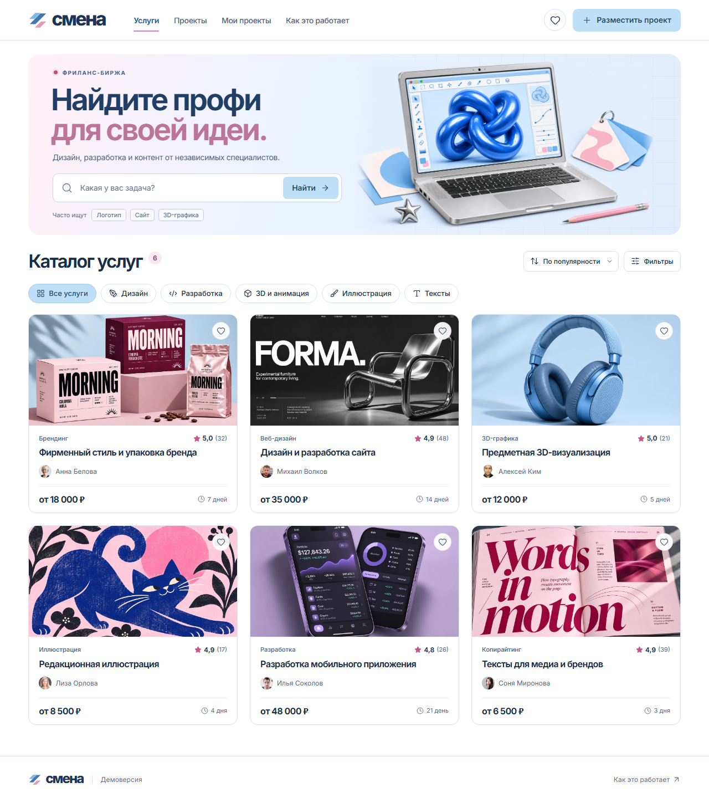

# Смена

«Смена» — прототип фриланс-биржи для заказа дизайна, разработки и контента. В каталоге заказчик может сравнить услуги по цене и рейтингу, посмотреть примеры работ и сохранить понравившиеся предложения в избранное.

Для задачи с собственными требованиями есть раздел «Проекты». Заказчик указывает бюджет и срок, а затем может отредактировать объявление, закрыть или снова открыть приём откликов.

